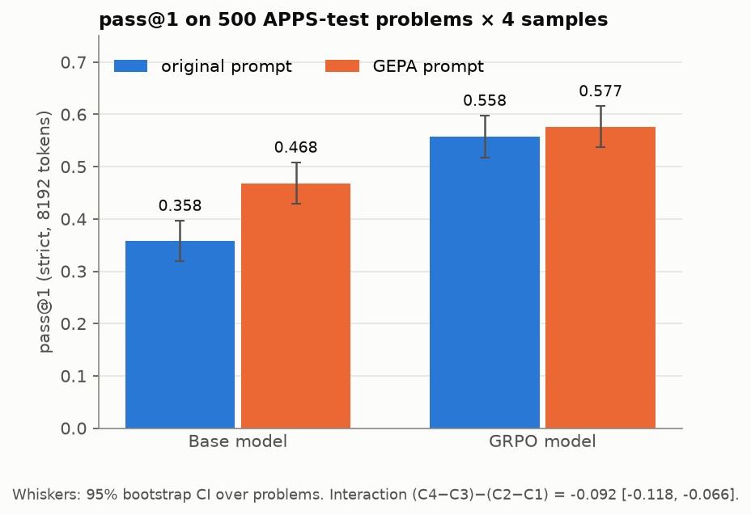
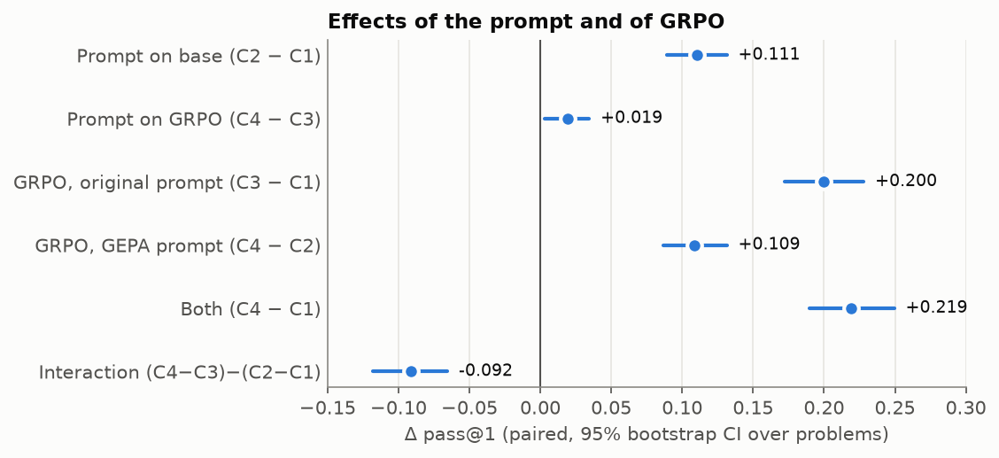
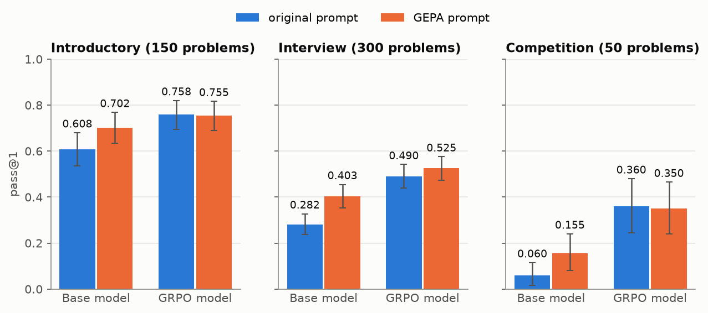
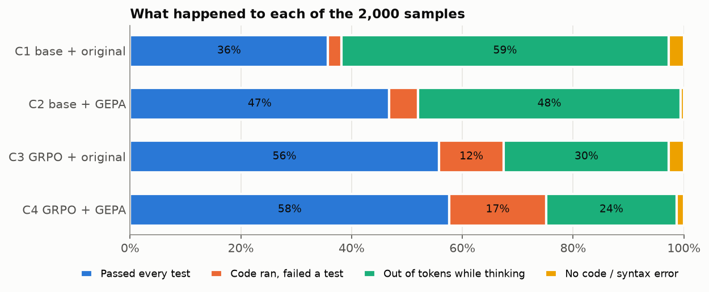
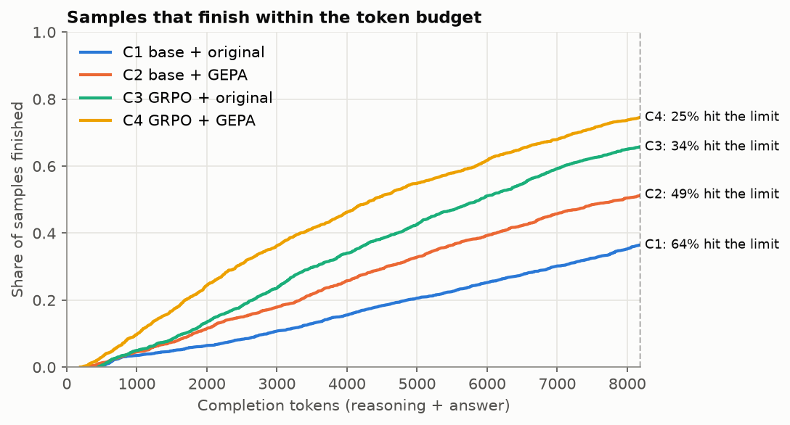
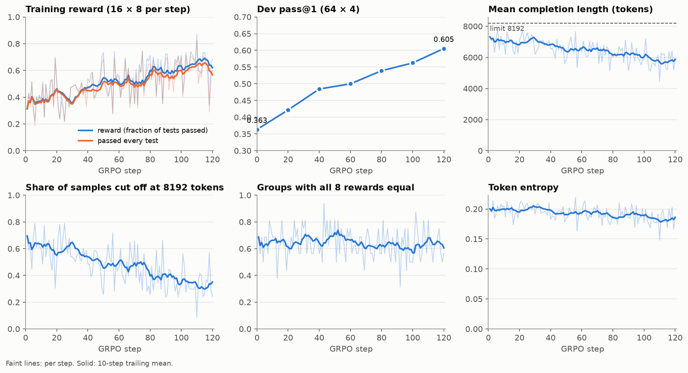
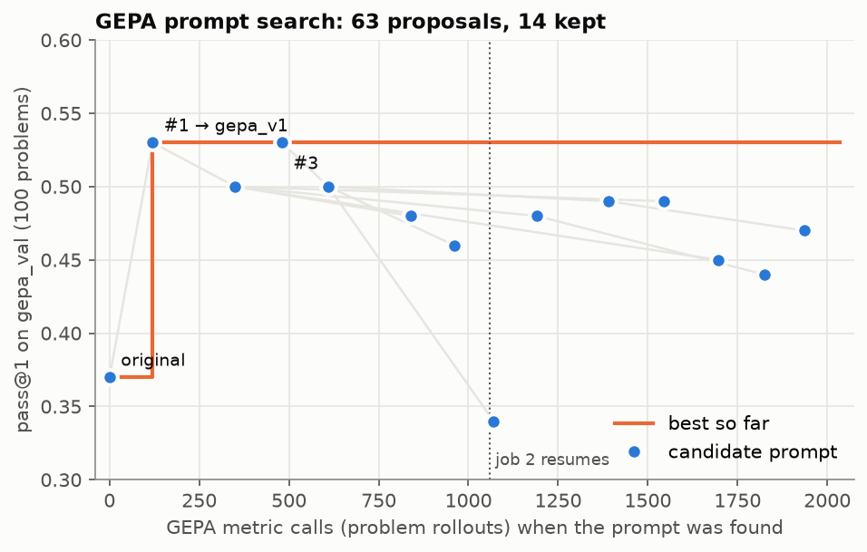
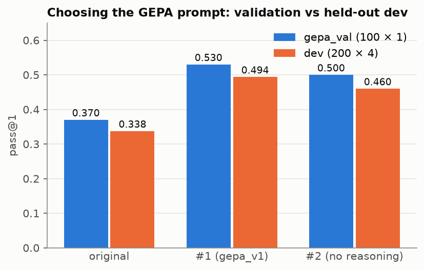
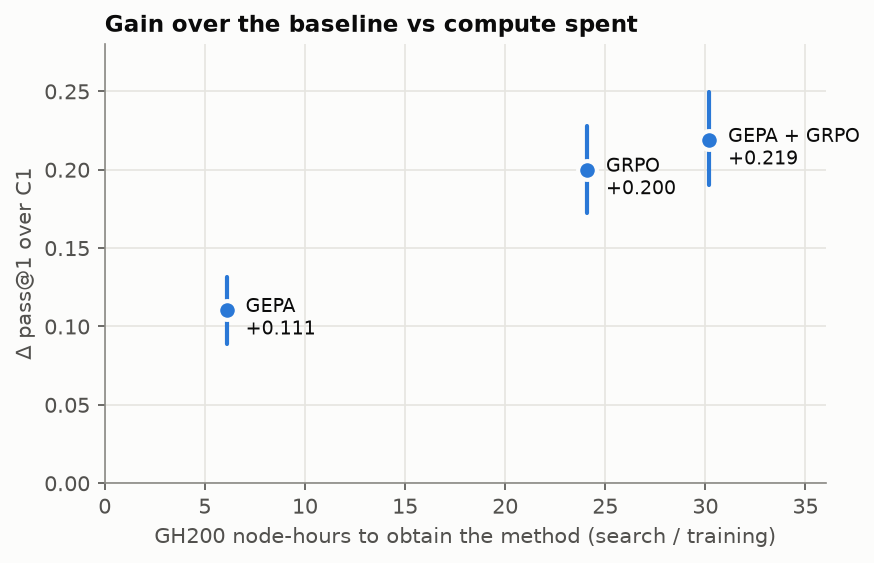

# Results: GEPA × GRPO on Qwen3-4B-Thinking-2507 (APPS-test)

## Setup (held fixed across all four conditions)

- **Model:** Qwen/Qwen3-4B-Thinking-2507.
- **Eval split:** a frozen sample of 500 APPS-test problems (150 introductory, 300 interview, 50 competition), with 4 samples per problem. GEPA and GRPO never saw these problems, and no decision was made on them.
- **Sampling:** temperature 0.6, top-p 0.95, top-k 20, seed 0.
- **Token limit:** `max_tokens` 8192, shared by the reasoning and the answer.
- **Strict scoring:** a sample cut off inside `<think>` has no answer and scores 0.
- **pass@1:** the mean over problems of the fraction of a problem's samples that pass every test.
- **Statistics:** `codegen.compare` gives 95% bootstrap intervals over problems (10,000 resamples), paired bootstrap intervals for differences, and McNemar's exact test on matched (problem, sample index) pairs. The output is in `comparison.json`.
- **C1's per-sample scores** are rebuilt from the budget-forced run (`:strict`), and the rebuilt score matches the original strict run exactly (0.3575).

Conditions and runs:

| | Original prompt | GEPA prompt (`gepa_v1`) |
|---|---|---|
| **Base model** | C1 (`c1-3538415`) | C2 (`c2-1147254`) |
| **GRPO LoRA, checkpoint-120** | C3 (`c3-1145976`) | C4 (`c4-1147270`) |

## Main result

pass@1 with 95% bootstrap intervals:

| | Original prompt | GEPA prompt | Prompt effect |
|---|---|---|---|
| **Base** | **0.358** [0.320, 0.397] | **0.468** [0.429, 0.508] | +0.111 [0.089, 0.132] |
| **GRPO** | **0.558** [0.518, 0.598] | **0.577** [0.538, 0.616] | +0.019 [0.003, 0.035] |
| **GRPO effect** | +0.200 [0.173, 0.228] | +0.109 [0.087, 0.132] | |

**Interaction**, (C4 − C3) − (C2 − C1) = **−0.092** [−0.118, −0.066].

Paired tests. "Only first" and "only second" count the matched sample pairs where exactly one of the two conditions passes:

| Comparison | Δ pass@1 | 95% CI | McNemar: only first / only second | p |
|---|---|---|---|---|
| C2 vs C1 (prompt, base) | +0.111 | [0.089, 0.132] | 254 / 33 | 2e-43 |
| C3 vs C1 (GRPO, original prompt) | +0.200 | [0.173, 0.228] | 420 / 20 | 1e-98 |
| C4 vs C1 (both) | +0.219 | [0.190, 0.250] | 461 / 23 | 5e-107 |
| C3 vs C2 (GRPO vs prompt) | +0.090 | [0.070, 0.110] | 236 / 57 | 5e-27 |
| C4 vs C2 (GRPO, GEPA prompt) | +0.109 | [0.087, 0.132] | 270 / 53 | 4e-36 |
| C4 vs C3 (prompt, GRPO) | +0.019 | [0.003, 0.035] | 138 / 100 | 0.016 |

**Takeaways**

1. Each method helps on its own, and GRPO helps more: +20 points, against +11 for the prompt.
2. The two gains overlap more than they add up. On the GRPO model the GEPA prompt adds only 1.9 points. That gain is still significant, but the interaction is clearly negative.
3. C4 is the best condition, though only slightly better than C3.

## Figures

Made by `scripts/make_plots.py` (`uv run --no-project --with matplotlib --with numpy python scripts/make_plots.py`) from the per-sample outputs in `$WORK/gepa-grpo-runs`.

| | |
|---|---|
|  **1.** pass@1 for the four conditions |  **2.** Paired effects and the interaction |
|  **3.** pass@1 by difficulty |  **4.** Outcome of every sample |
|  **5.** Share of samples finished by each token count |  **6.** GRPO training curves |
|  **7.** GEPA search: candidates, lineage, best so far |  **8.** GEPA prompts on gepa_val vs dev |
|  **9.** Gain over C1 vs node-hours | |

Fig. 6 also shows that about 60% of GRPO groups had all 8 rewards equal throughout training (no learning signal from those problems), and that token entropy fell only slightly (0.20 → 0.18).

## Why the two gains overlap: the token budget

| | C1 | C2 | C3 | C4 |
|---|---|---|---|---|
| Out of tokens while thinking (`unfinished_think`) | 1,182 (59.1%) | 950 (47.5%) | 596 (29.8%) | 472 (23.6%) |
| Truncated at 8192 tokens (any part) | 63.6% | 48.6% | 34.3% | 25.5% |
| Mean completion tokens | 6,837 | 6,073 | 5,461 | 4,672 |
| Code ran (`ok`) | 763 | 1,039 | 1,350 | 1,502 |
| `no_code` / `syntax_error` | 40 / 15 | 1 / 10 | 35 / 19 | 4 / 22 |
| Problems all fail / mixed / all pass | 283 / 82 / 135 | 218 / 101 / 181 | 169 / 103 / 228 | 159 / 111 / 230 |

The main failure in C1 is running out of tokens while still thinking. In C1's budget-forced run, 41% of those cut-off samples pass once an answer is forced (see `C1.md`). Both methods mainly fix this:

- The GEPA prompt tells the model about the budget and asks it to reason briefly.
- GRPO is trained with a strict reward, where a truncated sample scores 0, so it learns to finish within the budget.

Once GRPO has shortened the reasoning, the prompt has less left to fix. With both, it still cuts truncation from 34% to 25%.

## By difficulty

| | C1 | C2 | C3 | C4 |
|---|---|---|---|---|
| Introductory (150) | 0.608 | 0.702 | 0.758 | 0.755 |
| Interview (300) | 0.282 | 0.403 | 0.490 | 0.525 |
| Competition (50) | 0.060 | 0.155 | 0.360 | 0.350 |

- GRPO's lead over the prompt is largest on competition problems (0.36 against 0.155). These need the most reasoning, and a prompt that asks the model to reason less can only help so much there.
- On the GRPO model, the prompt helps on interview problems (+3.5 points) and is neutral elsewhere.
- Per-difficulty numbers, especially for the 50 competition problems, have wide intervals.

## GEPA (C2 prompt search)

- **Setup:**
  - Package: `gepa` 0.1.4 with a custom adapter (`src/codegen/gepa_adapter.py`) that optimizes only the system prompt.
  - Data: `gepa_train` (100 problems) for the reflection minibatches of 5, and `gepa_val` (100 problems) for Pareto selection.
  - Scoring: the C1 sampling settings with one sample per problem, scored 1 only if every test passes.
  - Budget: 2,000 metric calls (one problem run counts as one call), with merges allowed.
- **What the reflection model saw:** Qwen/Qwen3-30B-A3B-Thinking-2507, served by vLLM on its own node. For each minibatch example it got:
  - the problem statement (up to 2,500 characters);
  - the first 1,000 and last 1,500 tokens of the reasoning;
  - the answer (up to 1,500 tokens);
  - the judge's feedback.
- **Run:** two 2-node jobs (1146293, 1146490), resuming from GEPA's `run_dir`. When the second job resumed, it re-scored the original prompt and got the same 37/100.
  - 63 iterations produced 63 proposed prompts.
  - 13 proposals beat their parent on the minibatch and were scored on the full validation set. With the original prompt, that makes 14 candidates.
  - Validation score went from 0.37 (original) to 0.53 (#1, found after 120 calls). No later candidate beat it: #3 tied at 0.53, and the rest scored 0.34–0.50.
- **Dev selection** (200 dev problems × 4 samples; GEPA never saw this split):

  | Prompt | Validation | Dev pass@1 | Dev truncated |
  |---|---|---|---|
  | original | 0.37 | 0.338 | 66.3% |
  | **#1 → `gepa_v1`** | 0.53 | **0.494** | 47.8% |
  | #2 ("Do not write any reasoning") | 0.50 | 0.460 | 52.4% |

  - #3 and #4 were not run on `dev`: they were waiting in the `gh` queue, and we picked #1 without them.
- **`gepa_v1`** (`src/codegen/prompts/gepa_v1.txt`):

  > You are an expert Python programmer with a strict token budget of 8192 tokens. Solve the programming problem by providing the correct solution in Python. Your reasoning must be extremely concise - state only the key insight and algorithm. Immediately output the code as the final answer with no extra text, explanations, or examples. The token budget is limited, so be direct and efficient. If the solution is impossible, output -1 or the appropriate answer as specified.

  - The last sentence ("output -1…") comes from training problems whose answer for impossible inputs is -1. It is mild overfitting to the training problems; we left it in rather than edit the prompt by hand after selection.
  - Every top candidate made the same move: state the budget and demand short reasoning. #2 says "Do not write any reasoning", yet still averages 6,600 tokens on `dev`, because the model thinks regardless. The instruction shortens the thinking; it does not remove it.

## GRPO (C3 weights)

- **Setup:**
  - Trainer: TRL `GRPOTrainer` with vLLM in colocate mode, a LoRA adapter of rank 32, and learning rate 1e-5.
  - Rollouts: 16 problems × 8 samples per step from the 756 `grpo_train` problems, with the original prompt and the same 8192-token limit.
  - Loss: `dr_grpo`, with no KL penalty (β 0) and no reward scaling.
- **Reward:** the fraction of tests passed. A sample that runs out of tokens is kept in the loss with reward 0.
- **Run:** 120 steps across seven jobs, ending in a long `gh` job (1140771). We stopped it during step 121 at the user's request and used checkpoint-120.
- **Dev curve:** 64 dev problems × 4 samples, every 20 steps.

  | Step | 0 | 20 | 40 | 60 | 80 | 100 | 120 |
  |---|---|---|---|---|---|---|---|
  | pass@1 | 0.363 | 0.422 | 0.484 | 0.500 | 0.539 | 0.563 | 0.605 |

  Dev pass@1 was still rising at step 120.

## Compute

All Vista runs used GH200 nodes (1 GPU each); 1 node-hour costs 1 SU.

| | Node-hours | 4B rollouts | 4B completion tokens | Other |
|---|---|---|---|---|
| **GRPO training** (7 jobs) | 24.1 | 15,360 training + 2,048 dev-eval | 99.1M (training) | — |
| **GEPA search** (2 jobs × 2 nodes) | 6.1 (3.05 per node) | 2,135 (GEPA counts 2,035; +100 from re-scoring the seed on resume) | 13.5M | Reflection LM: 63 calls, 1.00M prompt + 0.09M completion tokens, 627 s of generation |
| GEPA prompt choice on `dev` (3 prompts) | 1.3 | 2,400 | ~15M | — |
| Eval C1 | — (LS6, 3×A100, 3,957 s generation) | 2,000 | 13.7M | — |
| Eval C2 / C3 / C4 | 0.93 / 0.96 / 0.79 | 2,000 each | 12.1M / 10.9M / 9.3M | — |

- **Cost to obtain each method:** GEPA needed about a quarter of GRPO's GPU time (6.1 against 24.1 node-hours) and about 7× fewer 4B rollouts.
- **Gain per node-hour:** GEPA bought +11 points with that, GRPO +20. GEPA is cheaper per point, but GRPO reaches higher.
- **The reflection node was mostly idle.** It generated for 627 s out of about 3 hours. A smaller or shared reflection server, or an API model, would cut GEPA's cost close to 3 node-hours.
- **Inference cost:** the GEPA prompt and GRPO both shorten outputs, so they lower inference cost too. C4 uses 32% fewer tokens than C1.

## Caveats

- **One run per condition.** There is one GEPA run and one GRPO run, each with seed 0. The intervals cover variation across problems, not across training runs.
- **Weak tests can let wrong code pass.** Some APPS-test problems have only a few tests, so "passes every test" can overstate correctness. The `C1.md` spot check found real solutions.
- **The C1 strict run was on different hardware.** It ran on LS6 (A100), and the others on Vista (GH200). The sampling settings are the same, but its timing numbers are not comparable.
- **The final prompt was picked on `dev` from only part of the candidates.** It was chosen from 2 GEPA candidates plus the original prompt, not from all the top candidates.
- **GRPO was stopped before it plateaued.** A longer run would probably widen GRPO's lead.
